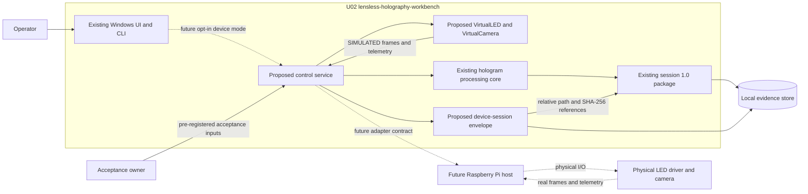
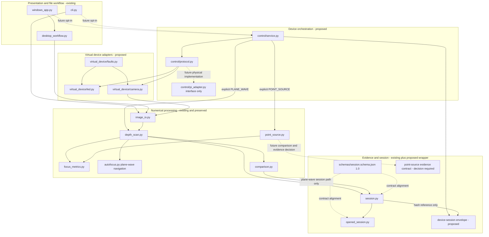
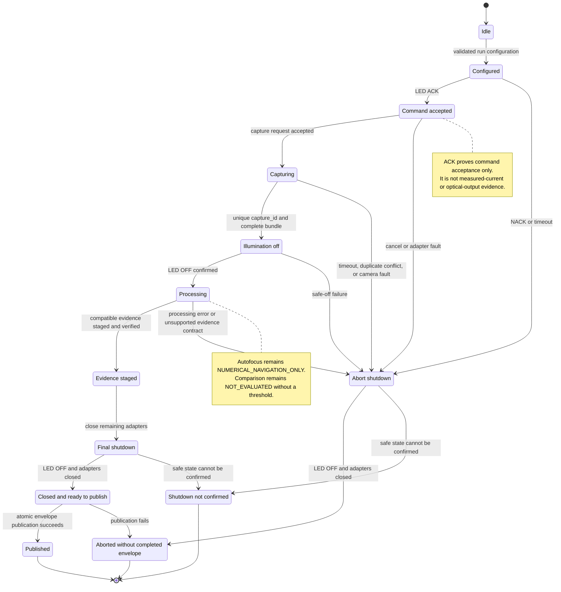

# U02 system architecture

## Document control

| Field | Value |
|---|---|
| Gate | `EXEC-G1` |
| Product | U02 `lensless-holography-workbench` |
| Baseline | `584486a4272e7a4a077db70d6688b4146a69f524` |
| Date | 2026-11-16 |
| Status | `RESEARCH_REFERENCE_ONLY` — ECAD/MBSE research reference; not an active U02 product architecture baseline |
| Requirements | [`requirements.md`](requirements.md) |

This document preserves a conceptual research architecture for a possible
future extension of the existing file-based U02 application with an optional
device-control path. It is not a product-roadmap commitment or an active U02
acceptance baseline; `EXEC-G2` and later device-integration gates are
`DEFERRED` unless separately authorized. It does not replace the current
numerical core, session 1.0, CLI, desktop workflow, or acceptance semantics.
Solid boxes labelled **existing** describe code at the baseline commit. Boxes
labelled **proposed** are research allocations only and must not be read as
completed implementation, committed roadmap scope, or physical-test evidence.

## Architectural principles

1. **Preserve the core.** Device integration delegates to the existing
   plane-wave, point-source, focus, comparison, and session APIs.
2. **Keep effects at the edge.** Hardware or simulation effects belong behind
   device adapters; numerical processing remains device-independent.
3. **Make the model explicit.** Plane-wave and point-source reconstruction are
   separate contracts and are never inferred from filenames or hardware.
4. **Keep evidence typed by origin.** Virtual records say `SIMULATED`; real
   device evidence cannot be inferred from them.
5. **Keep session 1.0 closed.** Device provenance uses a separate wrapper and
   does not add fields or undeclared files to the current session package.
6. **Fail closed and finish safe.** Invalid, stale, timed-out, or faulted flows
   do not publish a completed device session and always attempt LED safe-off.
7. **Separate navigation from acceptance.** Numerical focus and comparison
   outputs cannot create physical-focus or customer-acceptance claims.

## System context



The operator can continue to use the existing file-based path without the
control service. The proposed path is additive and opt-in. A real Pi host and
physical devices are outside this software baseline; G1 allocates only their
future interfaces.

## Logical block architecture



### Block responsibilities

| Block | Status | Responsibility | Explicit non-responsibility |
|---|---|---|---|
| Windows UI / CLI / `DesktopWorkflow` | Existing | File selection, validated parameters, asynchronous scan workflow, preview, export, reopen | Device state, physical I/O, physical acceptance |
| Control protocol | Proposed | Versioned commands/responses, adapter lifecycle, IDs, timeout and error semantics | Numerical reconstruction |
| Control service | Proposed | Validate, order, correlate, select the processing model, publish evidence, and close safely | Reimplementation of propagation or session algorithms |
| `VirtualLED` | Proposed | Deterministic LED state and simulated telemetry, ACK/NACK, fault injection, safe-off | Physical current or optical-output proof |
| `VirtualCamera` | Proposed | Deterministic role-labelled frames and metadata, capture IDs, fault injection | Real RAW or Raspberry Pi proof |
| Pi adapter | Proposed interface only | Future mapping of the common adapter contract to Pi transports | A working driver or HIL result in G1--G3 |
| Plane-wave core | Existing | Background normalization, prepared wavefront, depth planes and metrics | Point-source geometry or physical-focus acceptance |
| Point-source core | Existing | Explicitly selected point-source reconstruction | Automatic parameter inference, session 1.0 export, or U02-T2 acceptance |
| Focus metrics | Existing | Versioned scoring of a valid amplitude plane | Depth-grid orchestration or physical-focus claim |
| Plane-wave autofocus | Existing | Deterministic navigation over `PreparedWavefront` planes | Point-source autofocus integration, implicit selected-depth change, or acceptance |
| Comparison | Existing | Difference map, line profile, RMSE and maximum difference | PASS/FAIL without a registered threshold |
| Session 1.0 | Existing | Deterministic TIFF/CSV/JSON, SHA-256 coverage and strict reopen | Device provenance fields or undeclared sidecars |
| Device-session envelope | Proposed | Device/capture provenance and, for compatible plane-wave runs, cryptographic references to session 1.0 | Modification of the enclosed session or acceptance promotion |
| Point-source evidence contract | Undecided | Future representation compatible with `PointSourceReconstruction` | Reuse of the incompatible session 1.0 data model |

## Data flows

### Existing file flow

The existing plane-wave flow remains the default:

```text
signal/background/reference files
  -> immutable bounded snapshots and hashes
  -> image decoding and parameter validation
  -> explicit existing numerical backend
  -> selected numerical plane and optional unevaluated comparison
  -> session 1.0 TIFF/CSV/JSON/SHA-256 package
  -> strict, inspection-only reopen
```

The existing point-source backend is library-level numerical processing. Its
`PointSourceReconstruction` is not compatible with the `PreparedWavefront`,
`DepthScanResult`, and `PropagationParameters` inputs required by
`session.export_session()`. It therefore has no session 1.0 publication path.
A separate evidence contract requires an explicit later decision and shall
not be inferred or implemented by reusing session 1.0 fields.

### Proposed device flow

```mermaid
flowchart LR
    runConfig["Validated control-run configuration"]
    deviceCommand["DeviceCommand with request_id and timeout"]
    validate["Contract and state validation"]
    ledAdapter["LED adapter"]
    commandResult["ACK or NACK"]
    captureRequest["CaptureRequest"]
    cameraAdapter["Camera adapter"]
    captureRecord["CaptureRecord and immutable frame bytes"]
    illuminationOff["Immediate LED safe-off after capture"]
    captureBundle["Role-labelled capture bundle"]
    modelSelect{"Explicit processing model"}
    planeCore["Existing plane-wave core"]
    pointCore["Existing point-source core"]
    innerSession["Existing processing session 1.0"]
    pointBoundary["Point-source evidence contract not implemented"]
    envelopeDraft["In-memory device-envelope draft"]
    outerEnvelope["Atomically published device-session envelope"]
    failure["Defined error or timeout"]
    finalShutdown["Final safe-off verification and adapter close"]
    abortShutdown["Abort path safe-off and adapter close"]
    noPublish["No completed device-session envelope"]

    runConfig --> deviceCommand
    deviceCommand --> validate
    validate -->|"valid"| ledAdapter
    validate -->|"invalid"| failure
    ledAdapter --> commandResult
    commandResult -->|"ACK means accepted only"| captureRequest
    commandResult -->|"NACK or timeout"| failure
    captureRequest --> cameraAdapter
    cameraAdapter --> captureRecord
    cameraAdapter -->|"fault or timeout"| failure
    captureRecord --> illuminationOff
    illuminationOff -->|"OFF confirmed"| captureBundle
    illuminationOff -->|"safe-off failure"| abortShutdown
    captureBundle --> modelSelect
    modelSelect -->|"PLANE_WAVE"| planeCore
    modelSelect -->|"POINT_SOURCE"| pointCore
    planeCore --> innerSession
    pointCore --> pointBoundary
    captureRecord --> envelopeDraft
    commandResult --> envelopeDraft
    innerSession -->|"relative path plus exact JSON hashes"| envelopeDraft
    innerSession --> finalShutdown
    finalShutdown -->|"safe terminal state confirmed"| outerEnvelope
    finalShutdown -->|"close cannot be confirmed"| noPublish
    envelopeDraft --> outerEnvelope
    pointBoundary -->|"later evidence decision required"| abortShutdown
    failure --> abortShutdown
    abortShutdown --> noPublish
```



A capture bundle is a proposed orchestration concept, not a new numerical
backend. It binds immutable, role-labelled inputs such as `signal`, one or
more `background_N` frames, and an optional aligned reference. Its G2
contract must preserve the current rule that hashing and decoding consume the
same bytes. The persistence format and exact command sequence are deferred to
the ICD; neither may bypass existing image and parameter validation.

## Proposed control-session state machine

`ControlSessionState` is independent of the existing
`DesktopWorkflow.WorkflowState`. The latter remains
`EMPTY/READY/RUNNING/SCANNED/EXPORTED/REOPENED/ERROR/CANCELLED` and is not
extended by this proposal.



No terminal state in this machine is named `PASS`. `PUBLISHED` is reachable
only after LED safe-off and adapter close are confirmed, and means only that
the declared software evidence was written and verified. `ABORTED` and
`SHUTDOWN_FAILED` do not publish a completed device-session envelope.
Physical and customer acceptance remain external decisions governed by the
frozen U02 acceptance states.

## Device-session envelope proposal

### Isolation from session 1.0

[`session.schema.json`](../../schemas/session.schema.json) has top-level
`additionalProperties: false`. In addition,
`opened_session._strict_directory_files()` requires exact equality among
`session.outputs`, `sha256.json`, and the physical files in the session
directory. A device sidecar therefore cannot be silently placed inside an
existing session 1.0 directory.

For a compatible plane-wave run, the G1 proposal is an outer control-run
package:

```text
control-run-<control_session_id>/
|-- device-session.json          # proposed G2 contract
|-- device-sha256.json           # proposed envelope manifest
`-- processing-session/          # existing session 1.0 package, unchanged
    |-- session.json
    |-- sha256.json
    |-- metrics.csv
    |-- selected-plane.tiff
    `-- optional existing comparison outputs
```

The exact JSON Schema is an EXEC-G2 deliverable. At minimum, the envelope is
expected to contain:

- its own schema version and `control_session_id`;
- ordered command and response records with `request_id`;
- capture records with `capture_id` and their request correlations;
- data origin, fixed to `SIMULATED` for virtual-device records;
- injected timestamps, device parameters, device states, terminal state, and
  closed error codes;
- the explicitly selected processing model and compatible evidence type;
- a safe relative path to `processing-session/`;
- exact SHA-256 values for the inner `session.json` and `sha256.json`;
- `device-sha256.json`, covering every other managed file in the outer
  package but not recursively attempting to hash itself;
- publication status recorded only after safe-off and adapter close succeed.

The point-source backend does not use this inner session 1.0 structure. Its
future evidence type and package shape require a separate reviewed decision
before a completed point-source device envelope may be published.

This is an architectural recommendation only. G1 does not create a schema,
sidecar, runtime directory, or session modification.

## Nominal and failure scenarios

### Nominal virtual run

1. Validate the run configuration and explicit processing model; the
   publishable G1 design path is plane-wave processing with session 1.0.
2. Create deterministic IDs, clock values, seed, and fault plan from injected
   providers.
3. Send a versioned LED command and receive an origin-labelled ACK.
4. Request the role-labelled camera captures needed by the selected existing
   processing path.
5. Bind immutable frame bytes to capture records and one correlation chain.
6. Set the LED to safe `OFF` immediately after acquisition and verify that
   state before numerical processing.
7. Delegate numerical work to the selected existing core.
8. Publish and reopen the existing session 1.0 package using its current
   rules.
9. Close the remaining adapters and confirm the terminal safe state.
10. Publish the outer device-session envelope atomically only after all
    references, hashes, and terminal device states verify.

### Faulted run

For invalid input, NACK, timeout, duplicate conflict, cancellation, adapter
fault, numerical error, or evidence-publication error, the control service:

1. records a closed error code in the in-memory run result;
2. does not publish a completed device-session envelope;
3. invokes idempotent LED safe-off and adapter close;
4. does not convert the event into a physical or customer-acceptance result.

G2 shall decide whether a failed-run diagnostic record is publishable and,
if so, define it separately from a completed device-session envelope.

## Deployment and hardware boundary

The virtual configuration contains only the Windows/Python process and
in-process deterministic adapters. A future physical deployment may map the
same contract to a Pi control service and GPIO/I2C/SPI or an optional MCU, but
G1 provides no real driver and no hardware claim.

The v2 `V2-MBSE-G4` hardware decision precedes any `hardware/led-control/`
work. KiCad, ERC/DRC, BOM, Gerber, ngspice, HIL, measured current, optical
power, temperature, exposure, and RAW metadata remain outside this gate.
This G1 document contributes design evidence to `U02-HW-G1 = TASARIM`; it
does not promote `U02-HW-G2` or `U02-HW-G3` beyond `BEKLİYOR`.
Even a future ERC/DRC success cannot satisfy U02-T2, U02-T3, `U02-HW-G4`, or
`U02-HW-G5` by itself.

## Requirements allocation and planned evidence

| Requirement family | Primary blocks | Planned evidence families |
|---|---|---|
| `U02-SYS-*` | All layers and dependency boundaries | `U02-CT-ARCH-*`, `U02-CT-ADP-*`, `U02-IT-CTL-*`, `U02-REG-*` |
| `U02-LED-*` | Control protocol, LED adapter, control service | `U02-CT-LED-*`, `U02-VT-LED-*`, `U02-IT-SAFE-*` |
| `U02-CAM-*` | Control protocol, camera adapter, capture record | `U02-CT-CAM-*`, `U02-VT-CAM-*`, `U02-IT-CTL-*` |
| `U02-CTL-*` | Control service and adapter lifecycle | `U02-CT-CTL-*`, `U02-IT-CTL-*`, `U02-IT-SAFE-*` |
| `U02-IMG-*` | Existing numerical core | `U02-CT-IMG-*`, `U02-IT-IMG-*`, `U02-REG-CORE-*` |
| `U02-SES-*` | Existing session 1.0 and proposed outer envelope | `U02-CT-SES-*`, `U02-IT-SES-*`, `U02-REG-SES-*` |
| `U02-SIM-*` | Virtual devices and injected providers | `U02-CT-SIM-*`, `U02-VT-SIM-*`, `U02-IT-SIM-*`, `U02-IT-REP-*` |
| `U02-ACC-*` | All claim-producing boundaries | `U02-CT-ACC-*`, `U02-IT-ACC-*`, `U02-REG-ACC-*`, `U02-IT-T3-*` |
| `U02-VER-*` | Future test and evidence pipeline | `U02-CT-VER-*`, `U02-CT-TRACE-*`, `U02-IT-VER-*`, `U02-REG-SUITE-*` |

All planned contract, virtual-device, and integration tests use the existing
`unittest` discovery model. No new runtime or test dependency is introduced
by this architecture.
